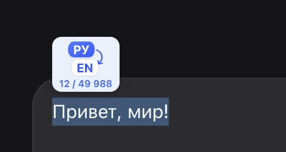

<div align="center">
  
</div>

# Inpulator

Translate your thoughts **right in the input field** — in chat, email, or forms. No translator tab, no copy-paste.

Select text → press the button or shortcut → the selection is replaced with a translation into your chosen language.

## Why

Writing in one language while thinking in another? The usual path: type → open a translator → copy → paste. Inpulator shortens that to two actions: **select and translate**.

## Features

- **In-place translation** — the selection is replaced in the same field
- **16 languages** — English, Russian, Ukrainian, Spanish, French, German, Portuguese, Italian, Dutch, Polish, Turkish, Chinese, Japanese, Korean, Arabic, Hindi; target language is chosen in settings
- **English and Russian UI** — follows the browser language
- **Auto-detect source** — Chrome's on-device language detector, even for short phrases; text in other languages it is confident about (e.g. Swedish) is translated too
- **Circular floating button** — next to the selection; icon shows pair codes (`ES → EN`); quota usage as a progress ring
- **Tooltip** — `ES → EN` or `ES → EN · 12% used` (exact counts live in settings)
- **Shortcut** — `Alt+Shift+T` (on macOS: `Option+Shift+T`)
- **Four providers** — MyMemory by default, Chrome Translator (on-device), Google Translate, DeepL
- **Settings** — segmented provider control, target language, Advanced (skip-languages combobox + change shortcut), Chrome packs, Google / DeepL API key, on/off, per-site toggle
- **Wide field support** — `<input>`, `<textarea>`, `contenteditable` (Gmail, ChatGPT, Slack, etc.), including Shadow DOM
- **Clear states** — spinner while loading; alert icon on the button when something fails (no toast)

## How to use

1. In settings, choose **Translate to** (default: English)
2. Type into any supported field
3. Select the fragment to translate
4. Press the translate button **or** the shortcut

More:

- **No selection** — press the shortcut with the caret in a field to translate the whole field (in block editors like Notion, the block under the caret)
- **Right-click the button** — pick another target language on the spot

5. The selection is replaced with the translation

The button appears when the selection language differs from the target and is not excluded. It disappears when the selection is cleared.

Open settings from the extension icon: target language, site toggle, provider (MyMemory / On-device / Google / DeepL), Chrome packs or the API key, and Advanced for skip languages / shortcut.

## Shortcut

| Platform        | Combination      |
| --------------- | ---------------- |
| Windows / Linux | `Alt+Shift+T`    |
| macOS           | `Option+Shift+T` |

Remap at: `chrome://extensions/shortcuts` (also linked from Advanced in the popup).

## Languages

| Code | Language   | Button label |
| ---- | ---------- | ------------ |
| en   | English    | `EN`         |
| ru   | Русский    | `RU`         |
| es   | Español    | `ES`         |
| fr   | Français   | `FR`         |
| de   | Deutsch    | `DE`         |
| pt   | Português  | `PT`         |
| zh   | 中文       | `ZH`         |
| ja   | 日本語     | `JA`         |
| ko   | 한국어     | `KO`         |
| ar   | العربية    | `AR`         |
| hi   | हिन्दी     | `HI`         |
| it   | Italiano   | `IT`         |
| nl   | Nederlands | `NL`         |
| pl   | Polski     | `PL`         |
| tr   | Türkçe     | `TR`         |
| uk   | Українська | `UK`         |

- **Target language** — listbox in settings
- **Skip languages** — excluded sources in Advanced; chip for language detected on the page, or typeahead in the combobox
- **Site** — the “This site” toggle adds/removes the domain from the block list

## Providers and limits

| Provider          | Limit (local)       | Notes                                                           |
| ----------------- | ------------------- | --------------------------------------------------------------- |
| MyMemory          | **50,000 / day**    | Default; cloud service, text is sent to MyMemory                |
| Chrome Translator | **No limit**        | On-device, Chrome 138+ desktop; no progress ring on the button  |
| Google Translate  | **500,000 / month** | Requires your own API key in settings; text is sent to Google   |
| DeepL             | **Your plan**       | Your own API key (Free: 500,000 / month); usage read from DeepL |

Google/MyMemory counters are stored locally and are an **estimate**, not exact API billing.

For Chrome Translator, packs are downloaded **for the needed language pair** (from selection and target) — in settings or automatically on the first translation. Browser pack management: `chrome://on-device-translation-internals`.

## Limitations

- Chrome Translator: **Chrome 138+ desktop** (not mobile)
- The button does not appear when source equals target, or the source is excluded
- Does not work in **cross-origin iframes**
- Rich text inserts plain text — formatting is lost
- Only text inside editable fields is translated; selecting regular page text does nothing
- After updating the extension, **reload the tab** (F5)

## Install

### From source

1. Download or clone the repository
2. `npm install && npm run build`
3. Open `chrome://extensions` and enable **Developer mode**
4. **Load unpacked** → select the **`dist/`** folder
5. (Optional) For Google Translate, create a personal [Cloud Translation API](https://cloud.google.com/translate/docs/basic/translating-text) key, restrict it to Translation API and a quota, then add it in settings

### Update

1. Pull the latest repository version and run `npm run build`
2. `chrome://extensions` → reload the extension
3. Reload open tabs

## Development

```bash
npm install
npm run dev            # rebuild dist/ on change
npm test
npm run lint
npm run test:e2e       # Playwright + Chromium with the extension loaded
npm run format:check
npm run package        # zip dist/ for the Chrome Web Store
```

## Privacy

Full policy: [PRIVACY.md](./PRIVACY.md).

- **Chrome Translator** — on-device translation; text does not leave the device
- **Google / MyMemory** — text is sent only if you chose that provider
- Stored locally: settings, usage counters, MyMemory email, and your Google API key (`chrome.storage.local`)
- Do not share your API key; restrict it to Cloud Translation API and quotas

## Developer docs

Technical documentation, architecture, file layout: [DOCUMENTATION.md](DOCUMENTATION.md)

## Stack

JavaScript (vanilla) · Manifest V3 · Chrome Translator API · Google Cloud Translation · MyMemory
